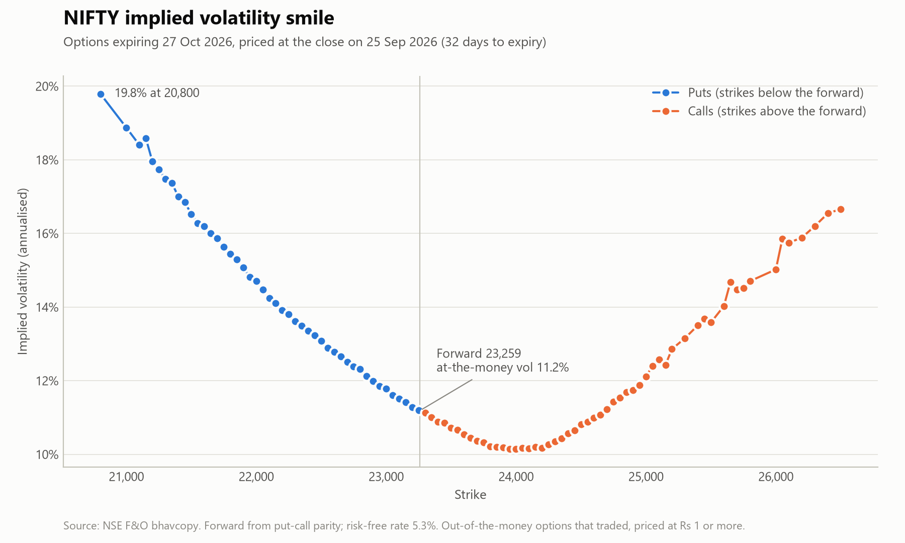

# Options Pricer

[](https://github.com/Dakshcore/options-pricer/actions/workflows/tests.yml)

Option pricing in Python, built from first principles and tested against theory: Black-Scholes-Merton with the Greeks, a binomial tree for American options, Monte Carlo simulation with variance reduction, and an implied volatility solver applied to real NIFTY option prices from NSE.



## Results

- **Black-Scholes** matches the worked example in Hull's *Options, Futures, and Other Derivatives*: a call worth 4.7594 and a put worth 0.8086.
- **The binomial tree** reproduces Hull's American put: 4.49 with 5 steps and 4.283 with 500, against 4.076 for the European put. The difference, 0.207, is the value of being able to exercise early.
- **Monte Carlo** prices the same call at 4.7621 ± 0.0025 with a million paths. For this call, antithetic variates halve the standard error; matching that without them takes about 4 times as many paths.
- **The NIFTY smile** comes from NSE's closing prices on 25 Sep 2026. Implied volatility is 11.2% at the forward and rises to 19.2% for strikes 10% below it, while strikes 5% above sit at 10.6%: the market pays up for protection against a fall.

## What's inside

| Module | What it does | Checked against |
|---|---|---|
| `pricer/black_scholes.py` | Black-Scholes-Merton price, delta, gamma, vega, theta and rho, with a continuous dividend yield | Hull's worked example, put-call parity, no-arbitrage bounds, finite-difference Greeks |
| `pricer/binomial.py` | Cox-Ross-Rubinstein tree for European and American options, vectorised with NumPy | Hull's American put, convergence to Black-Scholes, the early-exercise rules |
| `pricer/monte_carlo.py` | Exact GBM paths, antithetic variates and standard errors, for European and arithmetic Asian options | Black-Scholes, the closed-form geometric Asian price, 1/√n error scaling |
| `pricer/implied_vol.py` | Implied volatility by Brent's method, and the forward price from put-call parity | Round trips through the pricer, including Black's formula for options on a forward |
| `pricer/nse.py` | Downloads and reads NSE's end-of-day F&O file, the bhavcopy | Sample rows in NSE's file layout |
| `nifty_smile.py` | Builds the NIFTY smile and draws the chart above | — |

## Quick start

```bash
git clone https://github.com/Dakshcore/options-pricer.git
cd options-pricer
pip install -r requirements.txt
python -m unittest -v    # 36 tests
python nifty_smile.py    # downloads NSE's file, prints the smile and saves the chart
```

Tested on Python 3.13 with NumPy 2.5, SciPy 1.18, pandas 3.0 and Matplotlib 3.11.

## Usage

```python
from pricer import binomial as tree, black_scholes as bs, monte_carlo as mc
from pricer.implied_vol import implied_vol

bs.price(S=42, K=40, T=0.5, r=0.10, sigma=0.20, kind="call")   # 4.7594
bs.delta(S=42, K=40, T=0.5, r=0.10, sigma=0.20, kind="call")   # 0.7791

# American put: worth more than the European put (4.076) because early exercise can pay
tree.price(S=50, K=50, T=5/12, r=0.10, sigma=0.40, kind="put", steps=500, american=True)   # 4.283

estimate = mc.european(S=42, K=40, T=0.5, r=0.10, sigma=0.20, paths=1_000_000, seed=0)
estimate.price, estimate.std_error   # 4.7621, 0.0025
estimate.interval()                  # 95% confidence interval: (4.7573, 4.7669)

# Call on the average of 6 monthly prices: no closed form, so simulate
mc.asian(S=42, K=40, T=0.5, r=0.10, sigma=0.20, steps=6, seed=0).price   # 3.4931

price = bs.price(S=42, K=40, T=0.5, r=0.10, sigma=0.20)
implied_vol(price, S=42, K=40, T=0.5, r=0.10)   # 0.2000: back to the volatility that made the price
```

The Greeks use textbook units: vega and rho per 1.00 change in volatility or rate, theta per year. Divide by 100 for a percentage point and by 365 for a day.

## How the NIFTY smile is built

1. Download NSE's bhavcopy for 25 Sep 2026 and keep the NIFTY options expiring 27 Oct 2026, 32 days out, that traded that day: 184 contracts.
2. Back out the forward price from put-call parity, $`F = K + e^{rT}(C - P)`$, at the strike where the call and put prices are closest. It comes to 23,258.7, within 5 points of the October future (23,263.6), without needing a dividend estimate.
3. Keep the out-of-the-money side of each strike (puts below the forward, calls above), strikes within 15% of the forward, and prices of ₹1 or more, where NSE's ₹0.05 price step is small enough not to distort the volatility.
4. Solve each option for its implied volatility with Black's formula, which is the same code with the forward as the underlying price and q = r. The risk-free rate is 5.3%, in line with 91-day T-bill yields of 5.26–5.39% at the September 2026 auctions.

All 101 options solve. India VIX closed at 12.13 that day, a little above the 11.2% at-the-money volatility, as expected: VIX averages across strikes, including the richer out-of-the-money puts.

The file is cached in `data/` and not committed. If NSE's server refuses the automatic download, save the file from the URL in `pricer/nse.py` as `data/fo_bhavcopy_20260925.csv.zip`.

## Design notes

- **Standard errors with antithetic variates.** Each draw Z is paired with −Z, so the two halves of the sample aren't independent. The pricer averages each pair first and counts pairs, not paths; treating every path as independent would understate the error.
- **Exact simulation.** Each step moves the log price by $`(r - q - \sigma^2/2)\,\Delta t + \sigma\sqrt{\Delta t}\,Z`$, which is exact for geometric Brownian motion at any step size. European options need one step; only path-dependent payoffs need more.
- **Brent's method, not Newton's.** Far from the money, vega is close to zero and Newton's method can overshoot. Brent's method keeps the answer bracketed, after first checking the price is within the range the model can produce.
- **A guarded tree.** The risk-neutral probability of an up move must lie strictly between 0 and 1. With too few steps for the rate and volatility it doesn't, and the pricer raises an error rather than return a meaningless price.

## Tests

`python -m unittest -v` runs 36 tests:

- **Black-Scholes:** Hull's worked example, put-call parity, no-arbitrage bounds on the call, every Greek against a bump-and-reprice finite difference, and rejection of bad inputs.
- **Binomial tree:** Hull's American put (4.49 with 5 steps, 4.283 with 500), convergence to Black-Scholes, exact put-call parity for European options, and the early-exercise rules: never early for a call without dividends, sometimes early for a call with dividends, a premium over the European value for a put, and immediate exercise of a deep in-the-money put.
- **Monte Carlo:** European prices within 4 standard errors of Black-Scholes, the error halving with 4 times the paths, antithetic variates reducing it, the same seed giving the same result, simulated paths matching the exact price of a geometric-average Asian option, and the Asian call's place between them: worth more than the geometric version, less than the European, and exactly the European with a single averaging date.
- **Implied volatility:** solving recovers the volatility used to price an option, including on a forward with Black's formula; prices no volatility can produce are rejected; and put-call parity recovers the forward exactly.
- **NSE data:** the loader keeps only traded contracts for the requested index and expiry, finds the future and the index level, reads the zipped file with its dates, reuses a file already downloaded, and builds the download address for the right trading day.

## References

- John C. Hull, *Options, Futures, and Other Derivatives*, for the worked Black-Scholes and American put examples used in the tests.
- NSE's F&O bhavcopy archive: `https://nsearchives.nseindia.com/content/fo/BhavCopy_NSE_FO_0_0_0_YYYYMMDD_F_0000.csv.zip`

## Licence

MIT. See [LICENSE](LICENSE).
